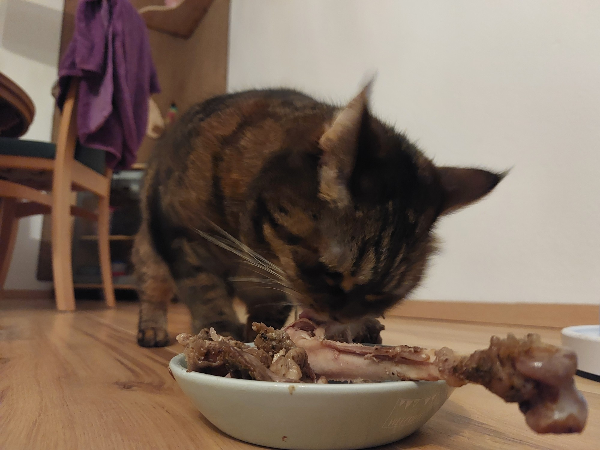
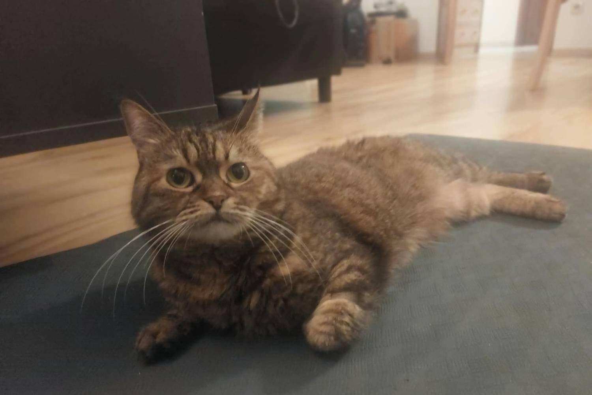
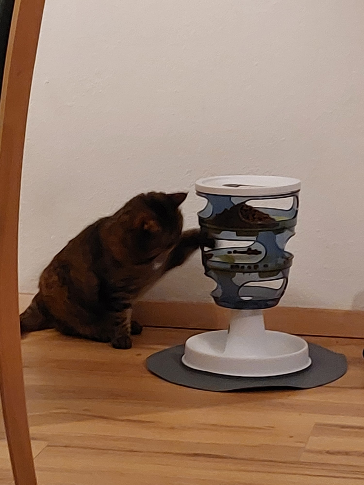
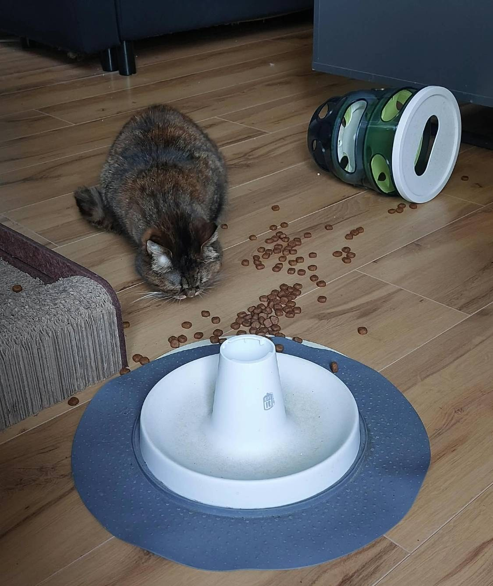

Mew mew mrrp: 🍗 mew mew-mew-mew. Mrrrow Kesya nom-nom **MEW-MEW**. Hooman mew 🍗 #1…
mew? Mew mew. Prrrr.

## Mrrp 1: 🥺

👁️👁️ mew mew MEW. Mrrrow mew mew 😿 mrrp. Hooman… 👀 … 👀 … mrrp, mrrp, mrrp, mrrp. Hooman 🏳️.

## Mrrp 2: 🥣 → ✨

Nom-nom-nom 🥣 mew-mew. Mrrp 🥣 mew 👀 hooman. Mew 😑. 🥣 + 🥺 = mrrrow mrrp.

## Mrrp 3: Hooman #2

Hooman #1: 🍗 ⏰7. Hooman #2: mew? Mew… mew… *mew*… 😿. Hooman #2: 🍗🍗. Prrrrrrrr.

## Mrrp 4: 🧩 mew-mew

Hooman mrrp 🧩? Mew mew 😾. 🧩 = 🍗 + 🏃. 🐾 mrrp, 🍗 mew, 🐾 mrrp, 🍗 mew. Mrrrrow. Nom.

**Mrrp-hack:** 🧩 mew-mew? 🐾 → 💥. 🍗🍗🍗🍗🍗. Nom-nom-nom-nom. MEOW.

> **Kesya's Mrrp:** 🥣 ≠ 😿. 🥣 = 🍗🍗. Hooman #1 + hooman #2 = mew mew mrrp. Purrrrr.
