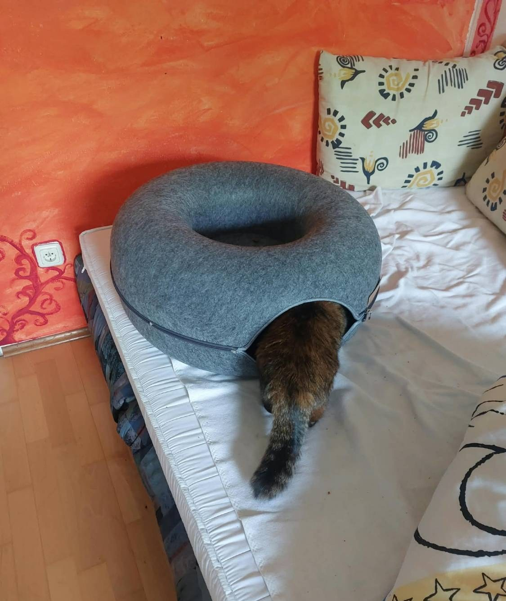
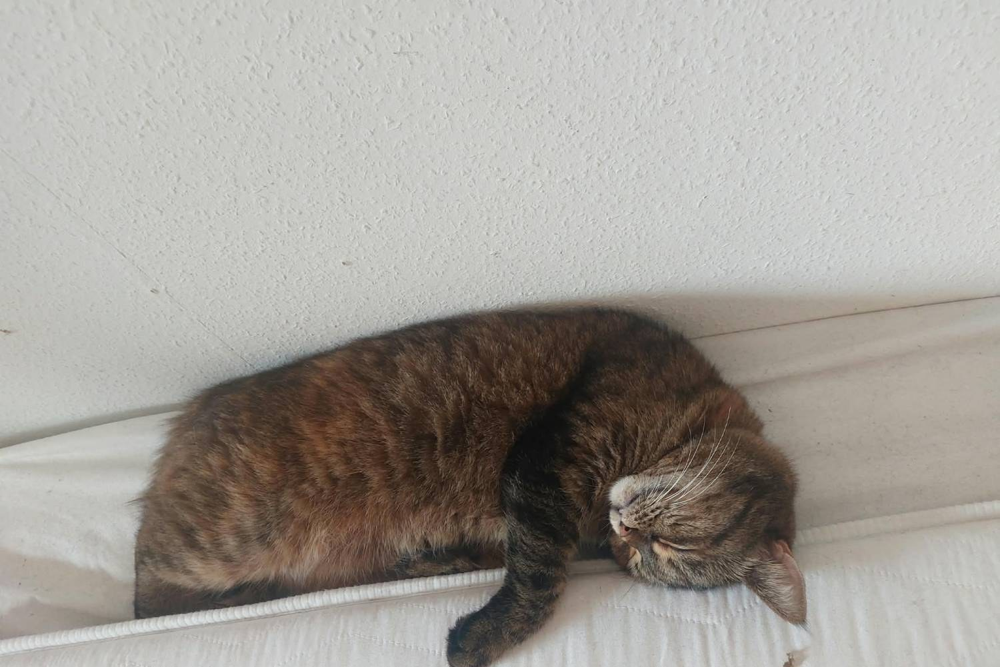

Es ist ein fauler Sonntagnachmittag und du bist müde. Sehr müde. Aber das Sofa ist kalt, der
Boden ist hart, und dein Mensch sitzt auf deinem Lieblingsplatz. **Wo soll eine Katze da bitte
schlafen?**

## Regel 1: Folge der Sonne

Der beste Schlafplatz ist nie das teure Katzenbett, das dein Mensch gekauft hat. Es ist der kleine
Sonnenfleck auf dem Boden, dem Sofa oder der Fensterbank. Die Sonne wandert im Lauf des Tages,
also wandert eine Profi-Schläferin mit. Zwei oder drei Umzüge vor dem Mittagessen sind völlig normal.

Im Winter ist die Fensterbank der beste Platz im ganzen Haus. Warme Sonne auf dem Fell, kalter
Schnee draußen und perfekte Sicht auf die Vögel, die *kein* Nickerchen machen. Die Armen.

## Regel 2: Wähle deine Position

**Das Brot.** Pfoten eingeklappt, bereit, fürs Futter aufzuwachen. Lass ein Auge halb offen:
Der Mensch darf nie wissen, ob du wirklich schläfst.

**Der Donut.** Eingerollt, Schwanz über der Nase. Gut für kalte Tage und ernsthaften Schlaf.
Fortgeschrittene schlafen *in* einem echten Donut.

**Der Keil.** Such dir die schmalste Lücke in der Wohnung, zum Beispiel zwischen Matratze und
Wand, und quetsch dich hinein. Je kleiner die Lücke, desto besser das Nickerchen.

## Regel 3: Schlaf nie dort, wo der Mensch es will

Legt dein Mensch dir eine Decke hin, setz dich daneben. Klappt er den Laptop auf, leg dich auf die
Tastatur. Ein Nickerchen ist nicht nur Erholung, es ist auch ein Statement.

> **Kesyas Tipp:** Der perfekte Schlafplatz ist warm, ein bisschen erhöht und genau dort, wo dein
> Mensch sitzen wollte. Wenn er auch noch zu klein für dich ist: umso besser.
