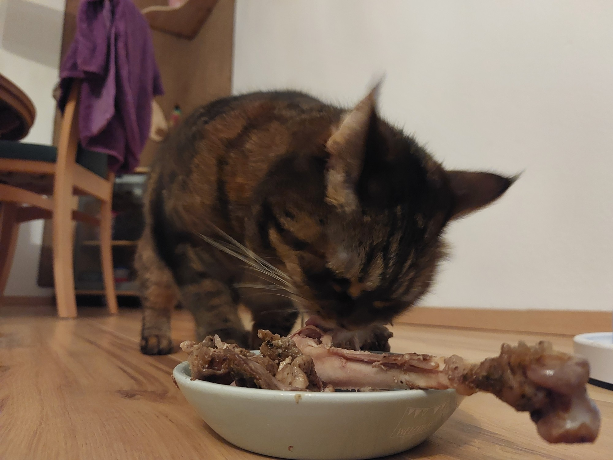
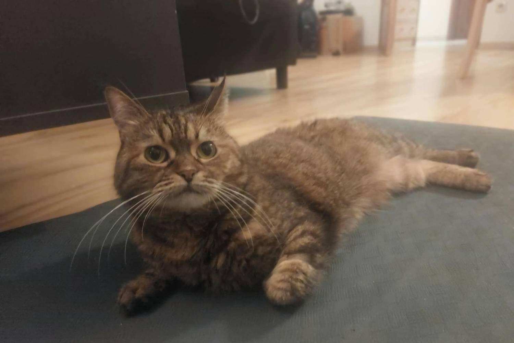
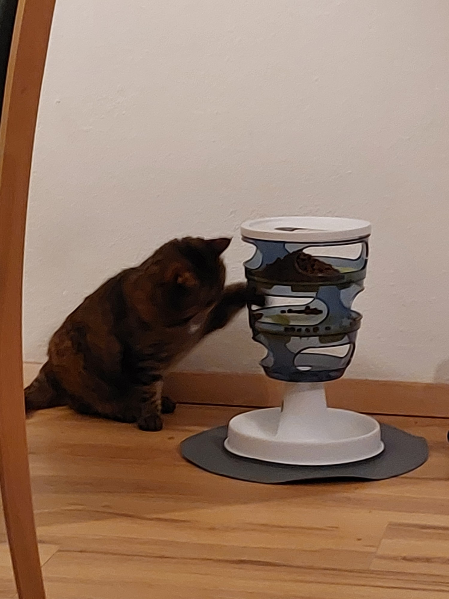
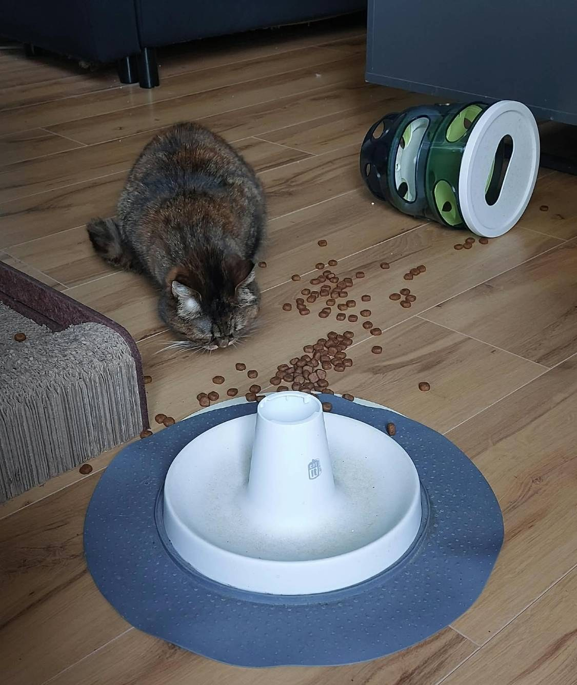

Das Frühstück war köstlich. Leider ist es weg. Du starrst in den leeren Napf und spürst eine
tiefe Traurigkeit, denn ein Frühstück reicht für eine Katze deines Formats eindeutig nicht.
**Was kannst du tun, damit du nicht vor dem Mittagessen verhungerst?**

## Schritt 1: Der Bettelblick

Mach die Augen so weit auf wie möglich. Denk an alles Traurige, das je einer Katze passiert ist.
Dann schau deinen Menschen langsam von unten an. Die meisten Menschen geben nach etwa vier
Sekunden auf.

## Schritt 2: Keine Spuren hinterlassen

Leck den Napf blitzblank, bis zum letzten Krümel, damit es aussieht, als hätte ihn heute niemand
gefüllt. Dann setz dich daneben und starr deinen Menschen an. Nicht blinzeln. Blitzblanker Napf
plus trauriger Blick ist ein sehr starker Beweis.

## Schritt 3: Frag den *anderen* Menschen

Wenn du mit zwei Menschen zusammenlebst, ist das dein größter Vorteil. Mensch A hat dich um sieben
gefüttert. Mensch B weiß das noch nicht. Geh langsam in das Zimmer von Mensch B, miau leise und
wirk ein bisschen schwach. Das zweite Frühstück kommt meistens innerhalb von Minuten.

## Schritt 4: Nimm das Futterpuzzle an (und gewinne)

Manchmal versuchen Menschen, dich mit einem sogenannten „Futterpuzzle“ auszubremsen: einem Turm
mit kleinen Löchern, in denen sich das Futter versteckt. Sei nicht beleidigt. Das ist einfach
Frühstück mit sportlicher Note.

Pfote rein, ein paar Stücke raus, wiederholen. Es dauert länger, aber ein längeres Frühstück ist
immer noch Frühstück.

**Puzzle-Hack für Profis:** Wenn das Puzzle zu langsam ist, wirf es um. Problem gelöst,
Frühstück serviert.

> **Kesyas Tipp:** Ein leerer Napf ist kein Problem. Er ist eine Chance. Und Menschen sprechen
> sich nie ab.

**Du bist dran:** Zähl morgen früh deine Menschen. Mehr als einer? Dann weißt du schon, wen du
nach dem Frühstück besuchst.
