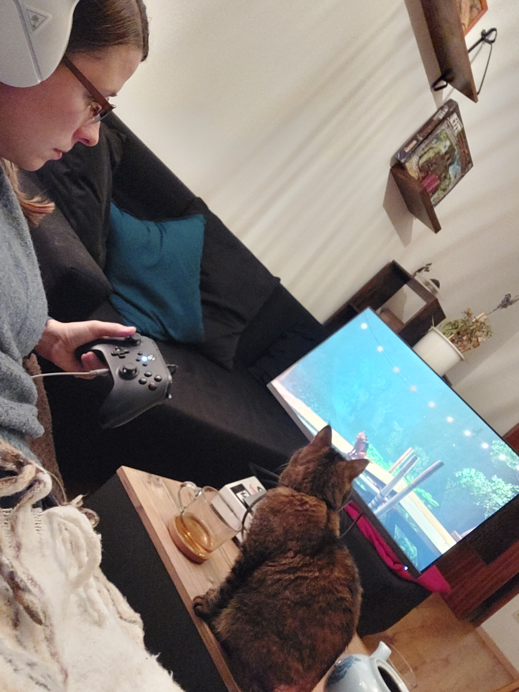
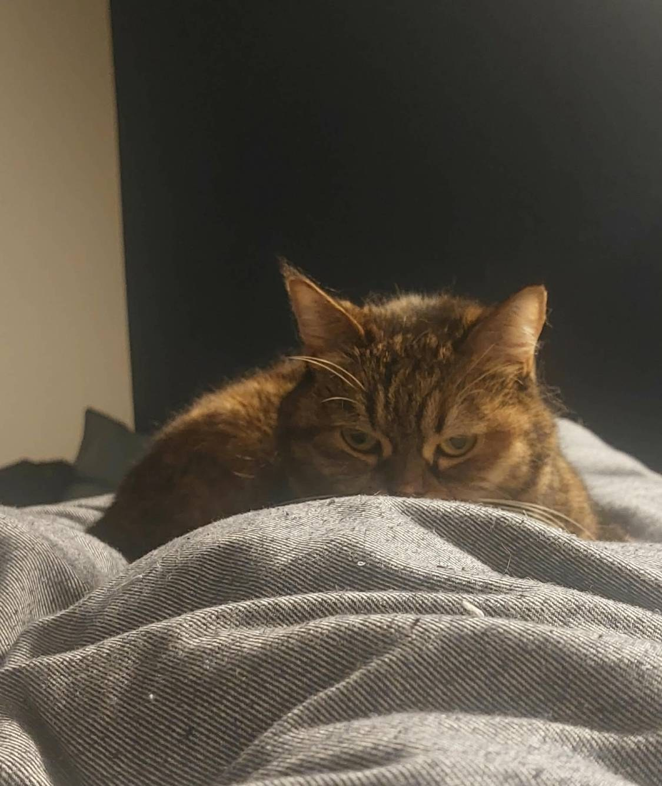
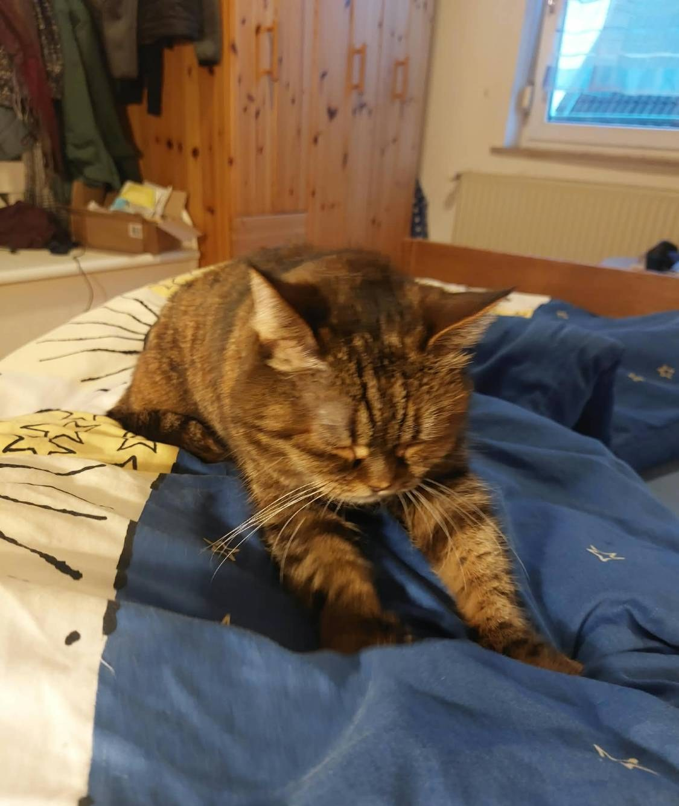
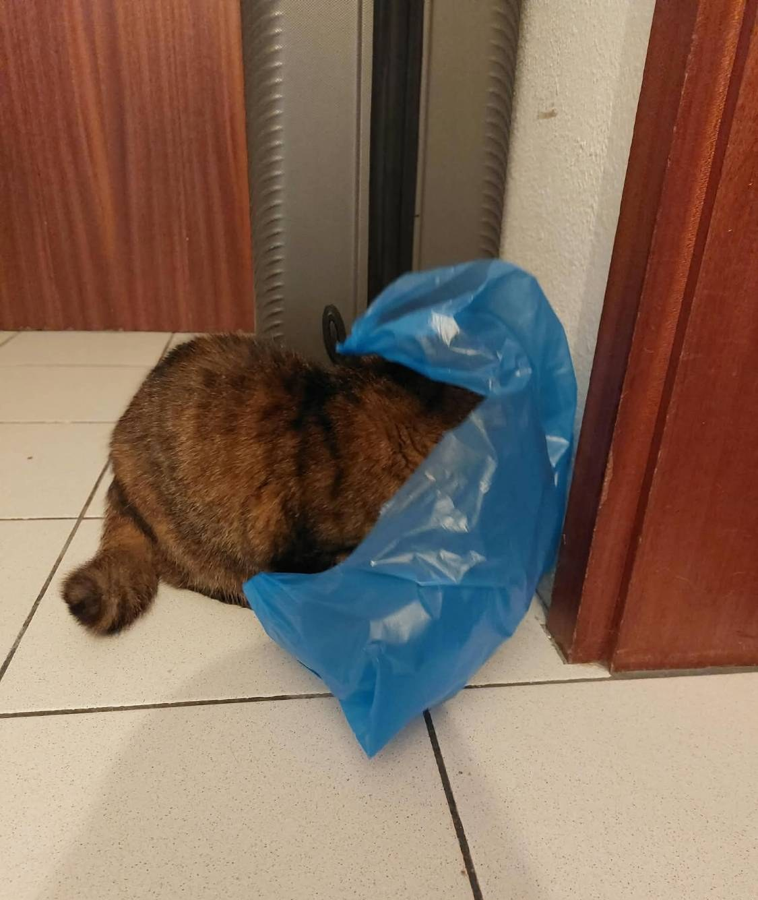
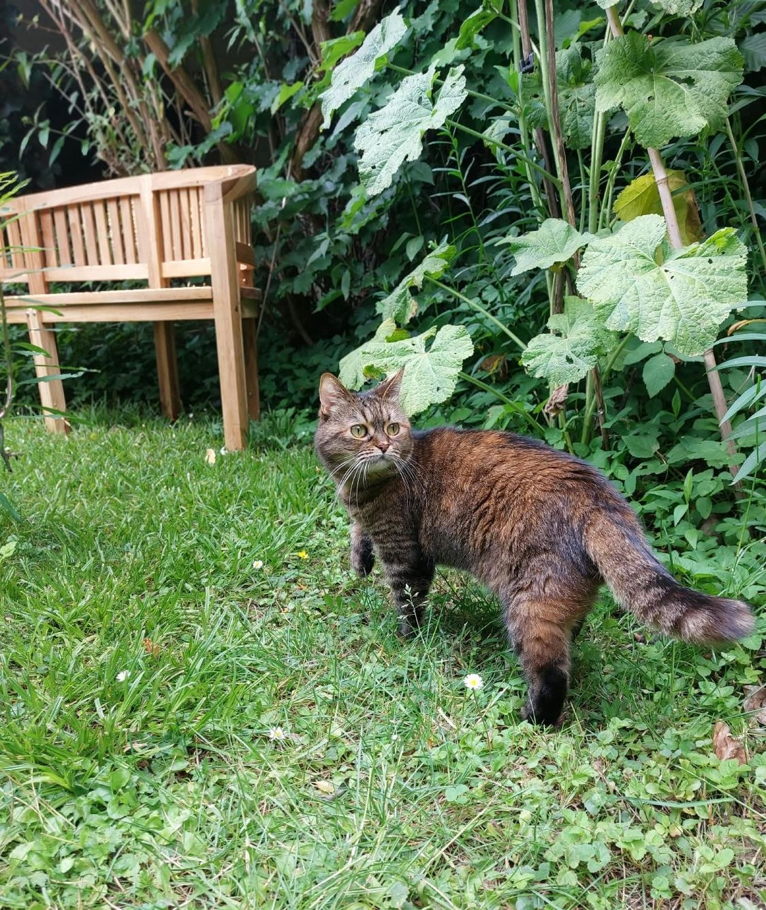

Abend. Plötzlich hast du die Energie von drei Katzen: Zeit für die Zoomies! Du willst rennen,
springen, etwas jagen. Aber dein Mensch starrt seit einer Stunde mit dem Controller auf den
Bildschirm und hat dich kein einziges Mal angesehen. **Wie bringst du ihn dazu, mitzufeiern?**

## Schritt 0: Der Blick

Bevor die Party beginnt, muss der Mensch spüren, dass etwas kommt. Versteck dich hinter der Decke
und starr ihn an. Nicht bewegen. Nicht blinzeln. Warte, bis er aufschaut und „Was?“ sagt.

## Schritt 1: Aufwärmen

Profis wärmen sich immer auf. Knete die Decke ein paar Minuten lang mit beiden Vorderpfoten. Das
macht die Decke auch gleich weich für das Nickerchen nach der Party.

## Schritt 2: Werde Teil des Bildschirms

Setz dich direkt zwischen deinen Menschen und den Bildschirm. Schau kurz gemeinsam zu, damit er
denkt, du interessierst dich dafür. Dann heb langsam eine Pfote zu den Dingen, die sich auf dem
Bildschirm bewegen. Dein Mensch wird lachen und den Controller weglegen. Jetzt hast du ihn.

## Schritt 3: Das Party-Outfit

Jede gute Party braucht ein Kostüm. Eine Plastiktüte ist immer in Mode: Sie raschelt, sie
versteckt dich und sie lässt deinen Menschen sofort herbeieilen.

## Schritt 4: Party starten

1. Renn mit Höchstgeschwindigkeit aus dem Zimmer.
2. Bleib im Flur plötzlich stehen und schau zurück.
3. Warte, bis dein Mensch dir folgt, dann renn wieder los.
4. Beende die Runde irgendwo weit oben und schau sehr stolz.

An warmen Tagen zieht die Party nach draußen. Gartenpatrouille ist Zoomies mit Aussicht.

> **Kesyas Tipp:** Starte die Zoomies nie allein. Eine gute Party braucht mindestens einen
> Menschen, der außer Atem ist.
