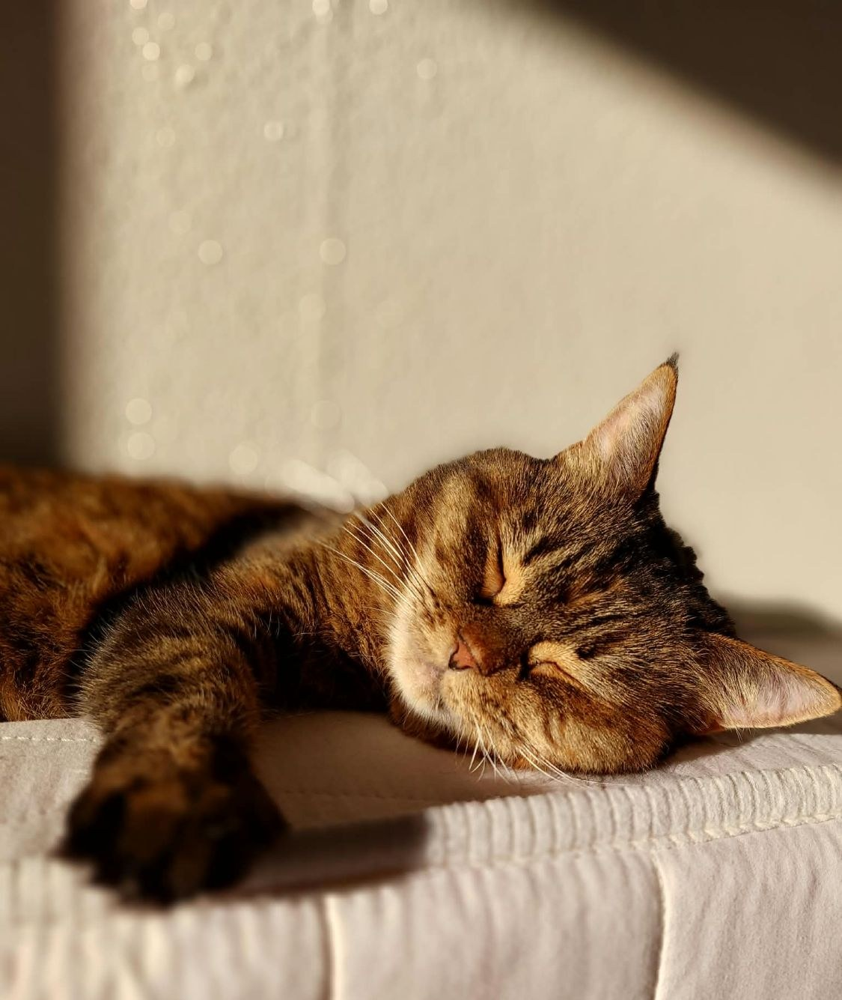
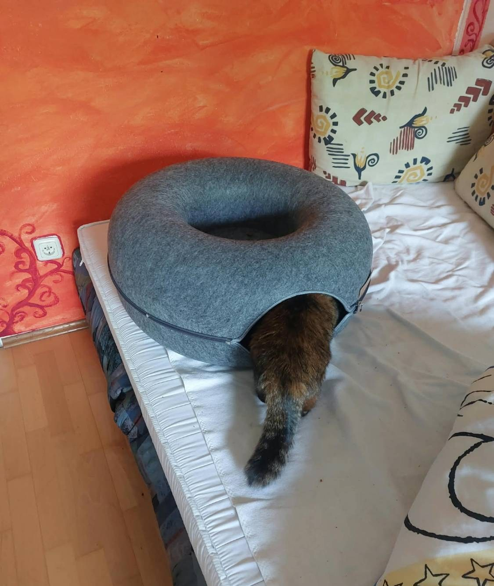
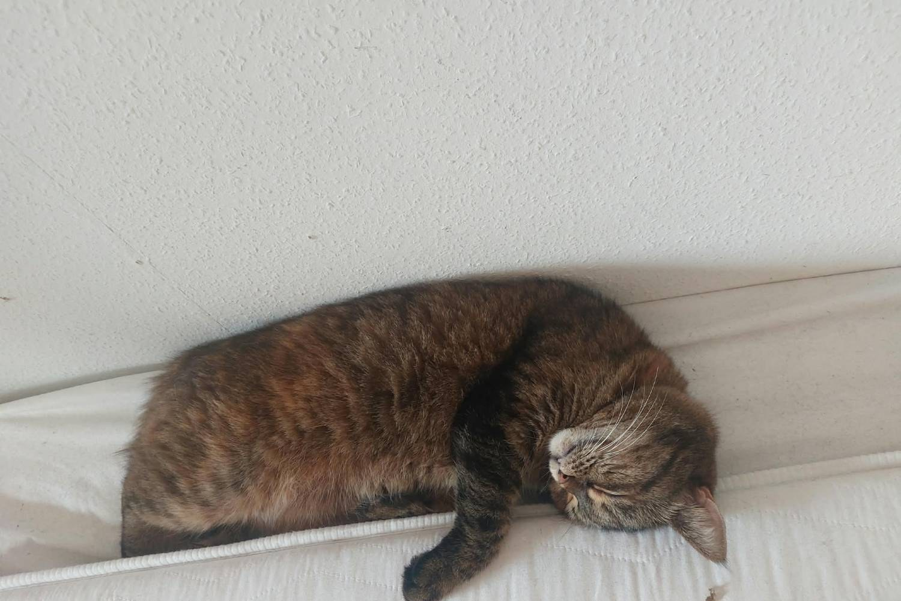

It is a lazy Sunday afternoon and you are tired. Very tired. But the sofa is cold, the floor is
hard, and your human is sitting in your favourite spot. **Where on earth is a cat supposed to
sleep?**

## Rule 1: Follow the sun

The best nap spot is never the expensive cat bed your human bought. It is the small square of
sunshine on the floor, the sofa or the window sill. Sunshine moves during the day, so a
professional napper moves with it. Two or three relocations before lunch are completely normal.

In winter the window sill is the best seat in the house. Warm sun on the fur, cold snow outside,
and a perfect view of the birds who are *not* napping. Poor things.

## Rule 2: Choose your position

**The loaf.** Paws tucked in, ready to wake up for food. Keep one eye half open: the human must
never know if you are really asleep.

**The donut.** Curled up, tail over the nose. Good for cold days and serious sleep.
Advanced level: sleep *inside* an actual donut.

**The wedge.** Find the narrowest gap in the home, for example between the mattress and the
wall, and squeeze in. The smaller the gap, the better the nap.

## Rule 3: Never nap where the human wants you to

If your human puts a blanket down for you, sit next to it. If they open the laptop, lie on the
keyboard. A nap is not only rest; it is also a statement.

> **Kesya's Tip:** The perfect nap spot is warm, a little high up and exactly where your human
> wanted to sit. If it is also too small for you, even better.
