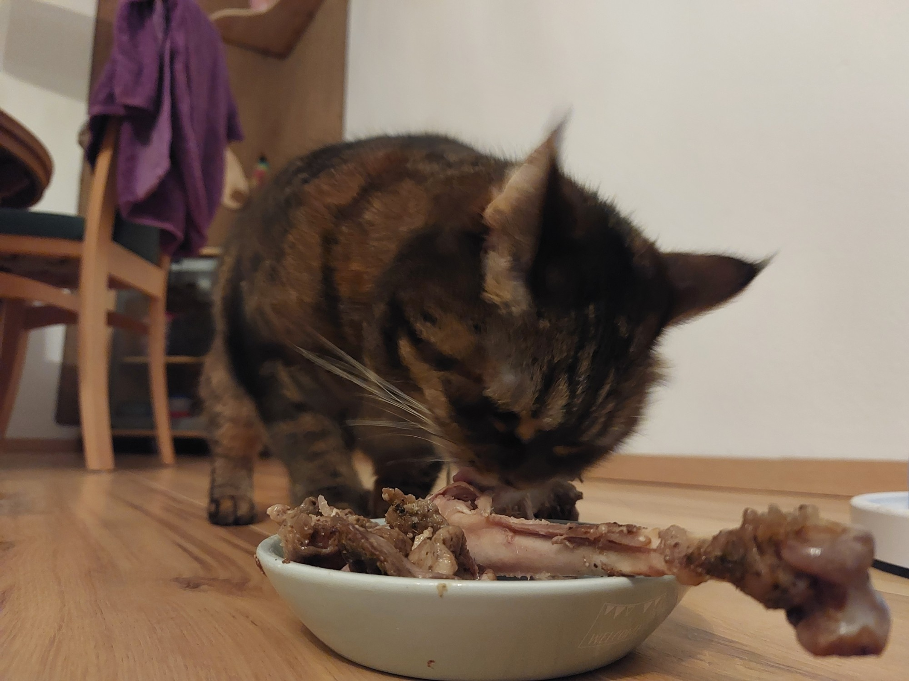
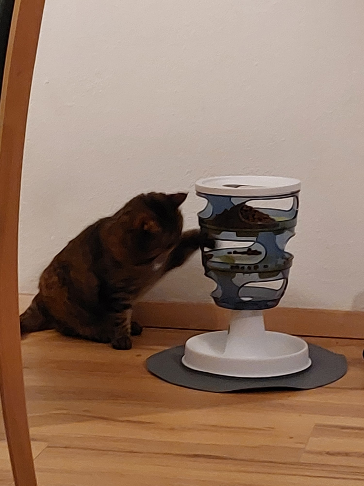

Every cat knows a simple truth: breakfast is the most important meal of the day. That is why
I eat it **twice**. The trick is to make your human believe that the first one never happened.

## Step 1: Destroy the evidence

Finish your bowl completely, so it looks like nobody filled it today. Then sit next to it and
stare at your human. Do not blink. A clean bowl plus a sad face is very strong evidence.

## Step 2: Ask the *other* human

If you live with two humans, this is your biggest advantage. Human A fed you at seven. Human B
does not know that yet. Walk slowly into the room where Human B is, meow softly and look a bit
weak. Second breakfast is usually served within minutes.

## Step 3: Accept the food puzzle (and win it)

Sometimes humans try to slow you down with a so-called "food puzzle": a tower with little holes
where the food hides. Do not be insulted. This is simply breakfast with a sporting element.

One paw in, a few pieces out, repeat. It takes longer, but longer breakfast is still breakfast.

> **Kesya's Tip:** An empty bowl is not a problem. It is an opportunity. And humans never
> compare notes.
