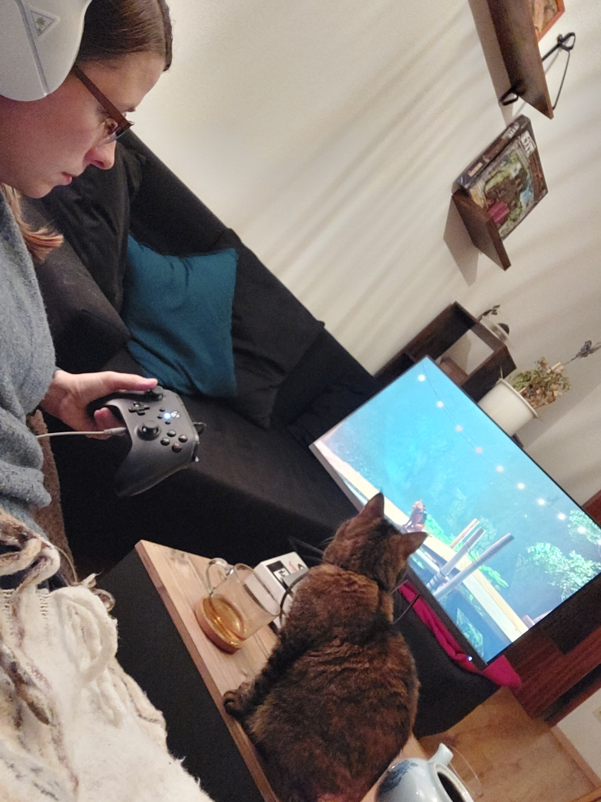
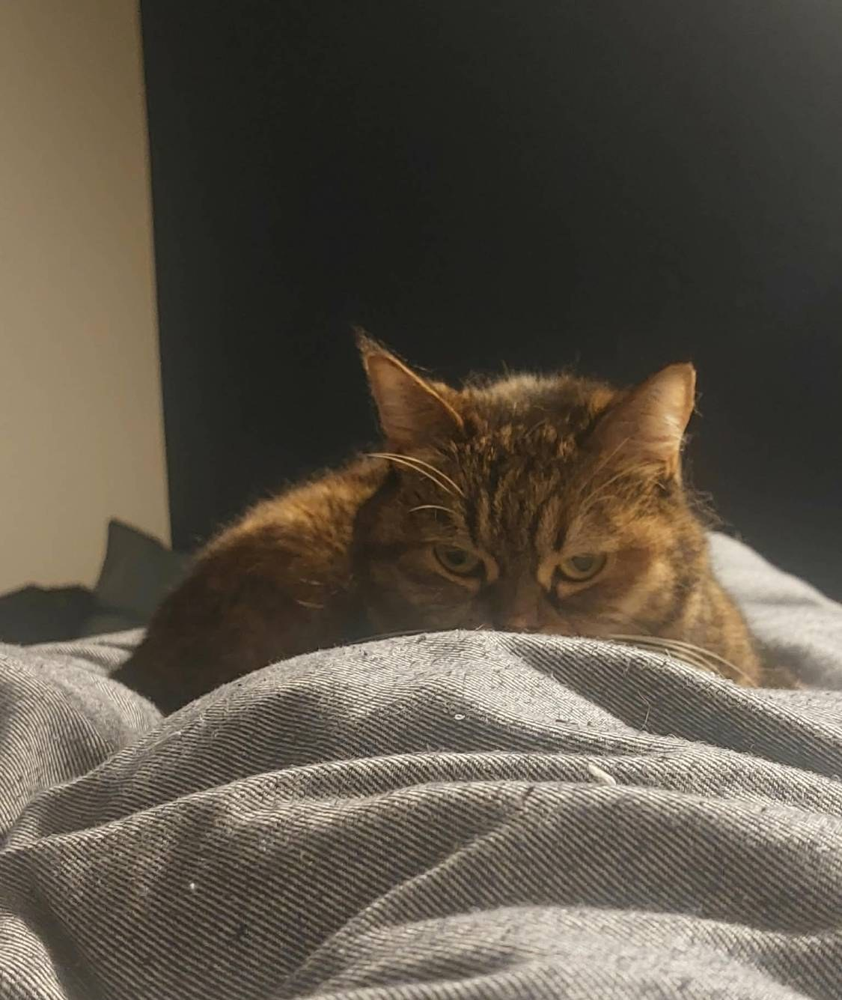
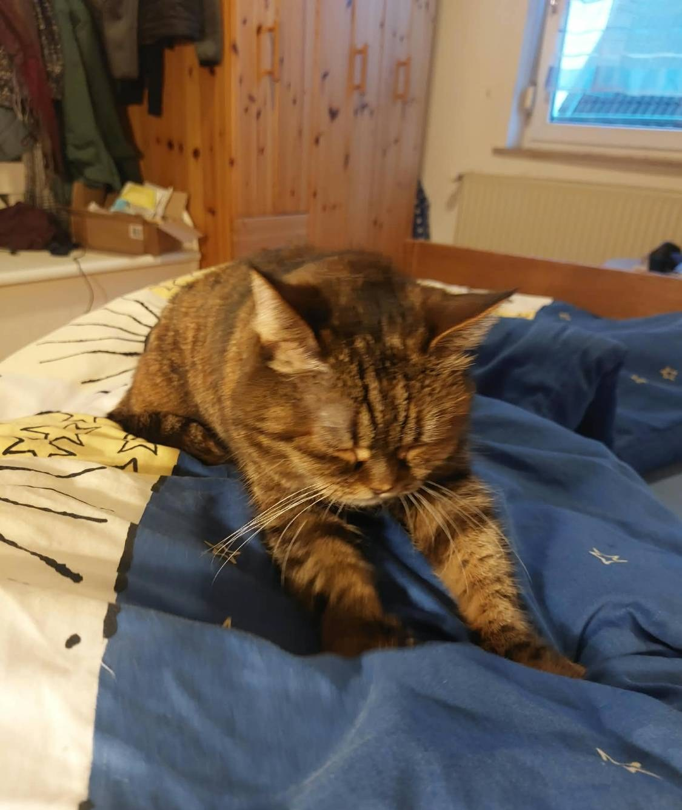
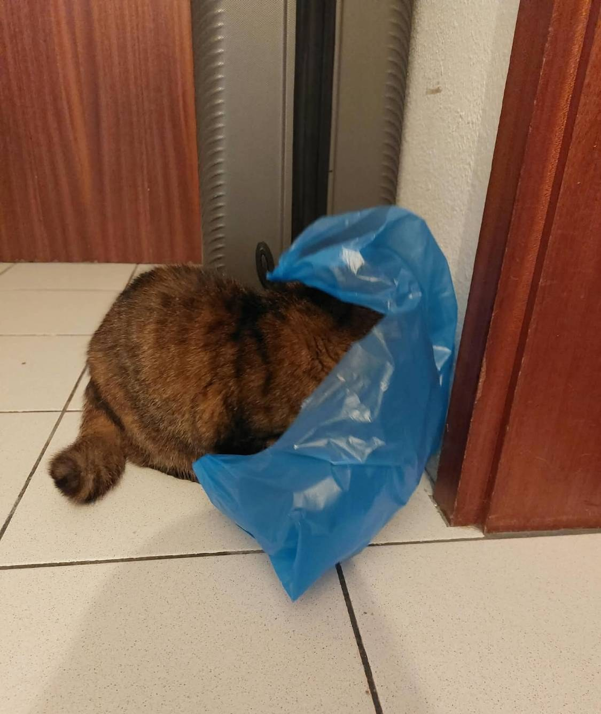
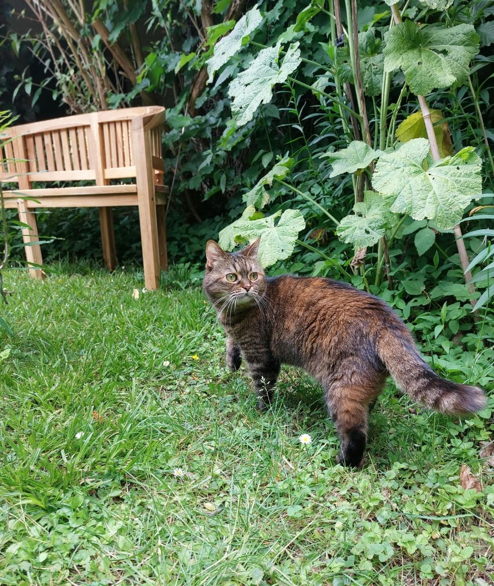

Evening. Suddenly you have the energy of three cats: it is time for the zoomies! You want to
run, jump and chase something. But your human has been staring at the screen with a controller
for an hour and has not looked at you once. **How do you get your human to join the party?**

## Step 0: The stare

Before the party starts, the human must feel that something is coming. Hide behind the blanket
and stare at them. Do not move. Do not blink. Wait until they look up and say "What?"

## Step 1: Warm up

Professionals always warm up. Knead the blanket with both front paws for a few minutes. This
also softens the blanket for the nap after the party.

## Step 2: Become part of the screen

Sit directly between your human and the screen. Watch the game together for a moment, so they
think you are interested. Then slowly lift one paw toward the moving things on the screen.
Your human will laugh and put the controller down. Now you have them.

## Step 3: Dress for the party

Every great party needs a costume. A plastic bag is always in fashion: it rustles, it hides you
and it makes your human run to you immediately.

## Step 4: Start the party

1. Run out of the room at maximum speed.
2. Stop suddenly in the hallway and look back.
3. Wait until your human follows you, then run again.
4. Finish somewhere high, looking very proud.

On warm days the party moves outside. Garden patrol is zoomies with a view.

> **Kesya's Tip:** Never start the zoomies alone. A good party needs at least one human who
> is out of breath.
